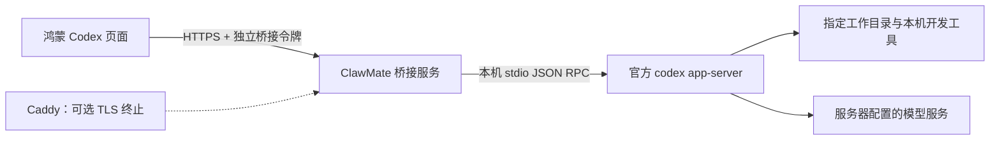

# 鸿蒙 App 远程 Codex：安装、连接与维护

本功能已加入底部导航，顺序为 **首页 → 汇总 → 聊天 → Codex → 任务 → 我的**。在 Codex 页连接自己的 PC 或云服务器，选择项目、模型和权限，然后聊天或下发任务。

## 采用的方案

选择 **OpenAI 官方 Codex App Server + 本仓库的 ClawMate HTTPS 桥接层**。App Server 是官方提供给自定义客户端的交互协议，支持会话、逐步输出和操作审批；这里使用其 stdio 传输。协议来源：[OpenAI App Server 文档](https://learn.chatgpt.com/docs/app-server)。

相比移植第三方移动客户端，这样可以直接使用现有 ArkUI 页面、系统文件选择器和安全存储，减少额外账号、中转服务与前端运行时。桥接代码只有 Node.js 标准库依赖，可以检查和自行维护。它是本仓库新增实现，并非已经过独立安全审计的成熟第三方产品。



这里的“云端”指你自己部署的服务器。它不对接 ChatGPT 托管 Codex Cloud 的任务 API，也不会同步 Codex 桌面端已有的任意会话。手机历史只显示由当前桥接实例创建的任务。

## 已实现的界面和行为

| 区域 | 可以做什么 |
| --- | --- |
| 连接卡片 | 填写 HTTPS 地址和桥接 token，选择是否记住连接，断开或忘记连接 |
| 任务配置 | 选择服务器预先允许的项目、模型、思考强度；新任务选择只读或工作目录内修改 |
| 聊天区 | 发送任务、继续追问、查看 Markdown 回答、执行输出、任务计划和文件 diff |
| 历史 | 查看当前服务器的任务；切换会话并继续之前的上下文 |
| 附件 | 系统相册选择图片或文档选择器选择文件；每项 8 MiB、每轮最多 6 项 |
| 审批卡片 | 检查命令、目录与申请原因，选择拒绝或仅允许本次；支持补充问题回答 |
| 状态 | 显示执行、待审批、完成、失败、中断；可以停止正在执行的任务 |

模型和思考强度从服务器动态读取，不写死某个模型。模型目录并不保证当前账号实际拥有调用权限；真实调用失败会显示在任务状态中。[官方模型列表说明](https://learn.chatgpt.com/docs/app-server#models)

模型切换在下一条消息生效。已有任务的项目和执行权限固定，换项目或权限需要点击“新任务”。只读分析限制 Codex 工具修改文件；主动上传的附件仍会由桥接服务写入项目。

## 1. 安装电脑端依赖

准备 Node.js **22 或更新的受支持版本**、Git、项目所需的构建工具，以及可使用 Codex 的账号或模型提供商配置。桥接服务无需 `npm install`，只有官方 Codex CLI 需要安装。

下面的 Codex 版本固定为本次本机验证的 **0.160.1**。升级时先运行本文末尾的验证步骤；官方协议仍在演进，不建议无验证地自动升级。

### Linux / macOS

安装好 Node.js 后，在准备运行桥接服务的普通用户账号下执行：

```bash
npm install -g @openai/codex@0.160.1
codex --version
codex login
codex login status

git clone https://github.com/doulujiyao12/mobiinfra-oh.git
cd mobiinfra-oh/bridge/codex
node server.mjs init "$HOME/.config/clawmate-codex/config.json" /absolute/path/to/your-project
```

如果已经有本仓库，直接进入 `bridge/codex` 即可。项目目录必须已存在。**配置目录与 stateDir 必须位于所有工作目录以外**，程序会检查这一点。

在没有桌面浏览器的 Linux 云服务器上，可以在服务器执行 `codex login --device-auth`，再按命令显示的步骤在自己的浏览器完成登录；是否允许设备登录取决于账号和工作空间设置。也可以按官方说明在服务器配置 API Key，密钥不需要交给手机。[Codex 登录说明](https://learn.chatgpt.com/docs/auth)

### Windows：原生运行

1. 安装 Node.js 22+ 和 Git。
2. 按 [官方 Codex CLI 安装说明](https://learn.chatgpt.com/docs/cli) 安装 Windows 原生 Codex。若使用 npm 安装，桥接进程需要找到安装包内真正的 `codex.exe`，不能把 `codex.cmd` 当作可执行文件直接启动。
3. 打开 PowerShell，进入项目目录，使用同一个 Windows 用户完成 Codex 登录。

```powershell
& 'C:\Tools\Codex\codex.exe' login
& 'C:\Tools\Codex\codex.exe' login status

git clone https://github.com/doulujiyao12/mobiinfra-oh.git
Set-Location mobiinfra-oh\bridge\codex
node server.mjs init "$env:LOCALAPPDATA\ClawMateCodex\config.json" 'C:\Projects\MyProject'
```

`C:\Tools\Codex\codex.exe` 是示例，请使用实际的原生可执行文件路径。在生成的配置中设置：

```json
"codexCommand": "C:\\Tools\\Codex\\codex.exe"
```

桥接通过 `shell: false` 启动 Codex，不运行来自手机的 shell 命令字符串。Windows 中配置文件的访问权限由其所在用户目录 ACL 控制；不要放进共享目录。

### Windows：WSL2 运行

也可以把 Node、Codex、项目和桥接全部装在 WSL2 中，按 Linux 步骤执行。项目优先放在 WSL 的 Linux 文件系统中。HTTPS 可以由 Windows 上的 Caddy 代理到 WSL 的桥接端口，或在 WSL 内直接启用 TLS。请实际验证 Windows 到 WSL 的端口转发与手机到 PC 的路由；桥接默认只监听回环地址，不能假设手机能够直接访问 WSL 的内部 IP。

## 2. 编辑服务器配置

初始化会生成随机 256 位桥接令牌，保存在配置文件的 `token` 字段。**在本机用编辑器查看并复制到手机，不要把配置上传到仓库、聊天或工单。** 这不是 OpenAI API Key。

以下字段是结构示例，token 使用初始化生成的真实值：

```json
{
  "name": "我的开发机",
  "host": "127.0.0.1",
  "port": 8787,
  "token": "保留-init-生成的随机值",
  "codexCommand": "codex",
  "stateDir": "/home/your-user/.config/clawmate-codex/state",
  "workspaces": [
    { "id": "app", "name": "鸿蒙项目", "path": "/home/your-user/projects/my-app" },
    { "id": "web", "name": "Web 项目", "path": "/home/your-user/projects/my-web" }
  ]
}
```

工作目录需要绝对路径；每项 `id` 唯一。手机只能选择这些目录，不能通过请求改变服务器 cwd。不同机器分别部署桥接服务，手机通过断开连接后修改地址来切换；当前只记住一组连接。

## 3. 为云服务器配置 HTTPS（推荐路径）

适合已有域名和可访问云服务器的场景。

1. 将你控制的域名，例如 `codex.example.com`，指向服务器公网地址。
2. 按 [Caddy 官方安装指南](https://caddyserver.com/docs/install) 安装 Caddy，修改仓库中的 [Caddyfile](../bridge/codex/deploy/Caddyfile) 域名。
3. 保持桥接配置的 `host` 为 `127.0.0.1`，启动桥接：

```bash
node server.mjs serve "$HOME/.config/clawmate-codex/config.json"
```

4. 在另一个终端启动 Caddy：

```bash
caddy run --config deploy/Caddyfile --adapter caddyfile
```

Caddy 使用系统服务部署时，把同样的站点配置放入系统 Caddy 配置并按其安装说明重载。需要允许证书签发使用的 80/443 端口；只有 443 对手机提供接口，8787 保持回环监听。Caddy 的签发、续期和 DNS 校验条件见 [Automatic HTTPS](https://caddyserver.com/docs/automatic-https)。

App 地址填写 `https://codex.example.com`，不带 `/v1` 或其他路径。当前协议要求独立 HTTPS origin，不能挂在 `/codex` 子路径下。

## 4. 为局域网 PC 配置 HTTPS

局域网也要求 HTTPS。可选以下两条路径。

### A. 有受信任证书的域名，局域网 DNS 指向 PC

给 PC 使用你控制的域名，获取匹配该域名的证书（例如通过域名服务商的 DNS-01 校验），在路由器或局域网 DNS 中把域名解析为 PC 的局域网 IP。使用 Caddy 加载该证书代理回环桥接，或让桥接自己监听 HTTPS。

桥接自己终止 TLS 的配置示例：

```json
"host": "192.168.1.20",
"port": 8787,
"tls": {
  "cert": "/absolute/path/to/fullchain.pem",
  "key": "/absolute/path/to/privkey.pem"
}
```

Windows 路径需要 JSON 转义，例如 `C:\\ClawMateTLS\\fullchain.pem`。`cert` 包含服务端证书及完整中间链。手机填写证书匹配的域名，如 `https://codex.home.example.com:8787`，不能随意改成 IP。防火墙只允许你的局域网地址范围访问该端口。

此方法无需把 PC 的桥接端口暴露到公网。证书与私钥不要放在 Codex 的工作目录中，PC IP 改变后也要更新 DNS。

### B. 自建 CA / 企业 CA

也可以使用局域网自建 CA 签发的证书，但手机系统和应用网络栈必须实际信任该 CA，证书 SAN 必须匹配填写的域名或 IP。不同 HarmonyOS 系统版本、设备管理策略对用户安装 CA 的信任行为可能不同；请用真机验证。若设备不信任该链，使用 A 方案或企业正式下发的受信任证书。

**App 没有忽略证书错误、接受任意自签名证书或 HTTP 明文模式。** 仅提供 IP 和任意自签证书不够。不要通过关闭校验解决连接问题。

也可以在可信私有网络或已有 VPN 内部署，仍应保留 HTTPS、桥接鉴权和适当的防火墙规则。

## 5. 手机连接与使用

1. 编译安装本次修改后的 App，进入底部 **Codex**。
2. 如旧版隐私同意需要更新，使用连接卡片中的“阅读并选择隐私声明”，或在“我的 → 个人与隐私 → 隐私声明”查看新版说明并同意。
3. 输入最终 HTTPS 地址与配置文件中的桥接 `token`，点击“安全连接”。记住连接时，地址和 token 绑定保存到系统 Asset Store；没有明文 Preferences 回退。
4. 新任务选择工作目录。先使用“只读分析”验证，例如“概括这个项目的目录结构”。需要实现或修复代码时，选择“允许工作目录内修改”。
5. 选择模型和思考强度。模型可能仍受账号权限和额度限制。
6. 输入任务。可通过“图片”上传 PNG/JPEG/WebP，通过“文件”上传其他文件；选择后立即上传，发送消息时再作为该轮输入引用。
7. 返回执行输出、文件 diff 和最终答复会显示在聊天区。执行记录可点击展开；阅读长输出时可关闭“自动跟随”。
8. 遇到审批时检查申请详情，再选择拒绝或仅允许本次；没有静默自动批准或整会话批准。

图片以服务器本地图片输入交给 Codex。其他文件通过受控的本地路径作为任务上下文，Codex 按需使用本地工具读取；PDF、压缩包、Office 等能否解析取决于服务器工具，不保证所有文件都能直接由模型理解。桥接不会自动解压文件，也不会执行上传的程序。

## 6. 长任务、重连与持久化

- 切换页面、App 切后台、手机断网或点击断开连接，都不会停止已经在电脑执行的任务。
- 页面可见时约每 2 秒取一次变化；暂时断网后逐步延长重试间隔。回到页面或重新连接后，通过“历史”重新打开任务。
- 手机离线时审批保持等待，不会因为等了很久而自动同意。
- “停止”向 Codex 发送中断请求；只有服务器确认后才显示已中断。已经执行的命令、文件修改或外部操作不会自动撤销。
- 桥接意外退出后，尚在执行的任务在重启时标为中断。发送新消息会恢复同一个 Codex thread，但不会自动重放上一条任务。
- 提交请求带防重复编号。网络响应丢失时先等待状态刷新；再次提交同一编号不会产生第二轮执行。
- UI 最多展示每任务最近 160 条记录，每条最多 48,000 字符，总量超过 100 万字符时还会移除更早记录；截断时会提示。完整 Codex 历史由 PC 上的 Codex 保存。

本版采用有界快照轮询，避免鸿蒙后台连接被回收后丢失状态。它不是逐 token 的 WebSocket 推送，也没有系统后台完成通知。任务完成后回到页面即可查看。

## 7. 安全边界和数据管理

此版本面向 **单个可信用户控制一台开发机/服务器**。一个桥接令牌可访问该实例允许的全部项目和任务，不提供团队租户隔离、不同用户的项目授权或互联网匿名注册。

已实施的保护：

- 默认只监听回环地址；非回环监听强制提供 TLS 证书和私钥。
- 每个接口校验独立桥接令牌；比较摘要使用恒定时间比较。令牌不在 URL、日志和错误消息中回显。
- 手机通过 RCP 关闭自动重定向，保持系统 TLS 校验；服务拒绝浏览器 Origin，没有公开 CORS 或任意 JSON-RPC 转发。
- 服务端固定 cwd、sandbox 和审批策略，不采纳手机注入的任意配置。默认只读；可写模式使用工作区沙箱、关闭普通工具网络访问。越界操作需要由 Codex 发起审批，用户必须显式处理。
- 未支持的交互请求拒绝执行，不自动批准动态工具、权限提升或 OAuth 操作。
- 附件名称检查、随机目录、独占创建、图片类型检查、文件大小和并发限制；已有附件在发给 Codex 前检查符号链接替换。
- 每个工作目录累计附件限额 512 MiB；实例最多 200 个任务。HTTP 请求按客户端地址限制频率，并限制请求体和超时。
- 配置和状态文件在 POSIX 上以 0600 创建，状态目录以 0700 创建；手机令牌使用不跨设备同步的 Asset Store。
- 隐私撤回会立即关闭手机通信并清除当前页面远程状态；不会假称已停止电脑任务。

**工作区沙箱主要是写入边界，不等于宿主文件读取隔离。** Codex 仍可能读取该 OS 用户可读的文件，已安装的 MCP、hooks 和工具也有各自权限。请用专用普通用户运行，账号中只放需要处理的项目；需要更强隔离时使用专用虚拟机或容器，并单独配置其网络、挂载和凭据。不应把个人主目录、SSH 私钥、生产密钥库或桥接配置所在目录作为项目。

本地同一 OS 用户和受其控制的进程属于可信边界。本服务不是针对同用户恶意进程的隔离容器，也不保证执行审批前所有项目内改动都逐项弹窗。“允许工作目录内修改”本身会授权 Codex 在该目录内编辑；“仅允许本次”的越界审批可能扩大该条操作的能力，应阅读具体申请。

桥接的任务快照保存在 `stateDir/tasks.json`，Codex 自己的上下文保存在运行用户的 Codex 数据目录。附件放在项目下的 `.clawmate-upload-<随机ID>/attachment.*`，不沿用客户端文件路径。请把 `.clawmate-upload-*/` 加入实际工作项目的 Git 忽略规则。

从输入区移除附件只取消本轮引用，**不会删除已经上传到 PC 的副本**。本版不自动清理附件，以保留会话继续读取的能力。需要清理时停止桥接、备份所需记录，在 PC 上清理相应上传目录与状态记录；删除后旧会话引用的附件将不可用。处理敏感文件前请确认这项保留规则。

令牌泄露时执行：

```bash
node server.mjs rotate /absolute/path/to/config.json
```

然后重启服务，在手机断开旧连接并输入新 token。轮换不会删除任务和附件；要撤销设备访问，旧进程必须完成重启。

## 8. 开机启动与故障检查

Linux 可以参考 [systemd 模板](../bridge/codex/deploy/clawmate-codex.service)，修改用户名、Node 路径、代码路径、配置路径与 PATH。先以该用户完成 Codex 登录，使用该用户能执行的 Codex 原生路径；不要以 root 运行。一个 stateDir 同时只运行一个桥接实例。

macOS 可用 launchd、Windows 可用任务计划程序常驻相同启动命令，使用已完成 Codex 登录的用户身份与正确工作目录。PC 休眠、WSL 退出或服务器关机会中断任务；手机端无法防止电脑休眠。

验证 HTTPS 和鉴权（不会把令牌写进命令行参数）：

```bash
node doctor.mjs /absolute/path/to/config.json https://codex.example.com
```

| 问题 | 检查 |
| --- | --- |
| 连接失败 | 手机能否路由到服务器；TLS 完整链、有效期和域名；PC 防火墙、DNS 与端口 |
| 令牌无效 | 是否使用桥接 config 的 token；轮换后是否重启；是否误填 OpenAI API Key |
| 重定向拒绝 | 输入最终 HTTPS origin；不允许子路径或 HTTP 跳转 |
| Codex 初始化失败 | 同一用户的 `codex --version`、`codex login status`、Codex 可执行路径和配置是否正常 |
| 模型在列表但执行失败 | 模型实际调用权限、套餐额度、提供商网络和账号配置 |
| Windows 找不到 Codex | 配置原生 `codex.exe` 完整路径，避免 `codex.cmd`；或使用 WSL2 路径 |
| 任务一直等待 | 检查审批卡片、问题回答及 PC 端状态；离线不会自动批准 |
| 命令环境不完整 | 服务账号的 PATH、编译器、依赖和环境变量与交互终端是否一致 |
| 附件失败 | 大小、格式、累计配额；相册 HEIC 等请先导出为 PNG/JPEG/WebP |
| 安全凭据读取失败 | 解锁设备重试，或忘记连接后重新配置；不会回退到明文保存 |

## 9. 开发验证和当前限制

```bash
cd bridge/codex
npm test
```

18 项自动化测试覆盖 HTTPS/鉴权入口边界、工作目录白名单、权限配置、附件、模型能力、状态事件、审批、重复提交、恢复，以及真实子进程 stdio 传输。测试使用模拟 Codex 事件，不会发起付费模型推理。

本次还在当前 Linux 环境使用真实 **codex-cli 0.160.1** 验证了 `initialize → initialized → model/list`，得到 7 个模型条目；没有用真实账号执行付费任务。5 类实际生成的 RPC 请求通过本机 `codex app-server generate-json-schema` 的 JSON Schema 校验。

另外提供了 [手机逻辑检查脚本](../scripts/check_codex_logic.cjs)，可在已经安装 TypeScript 的开发环境运行：

```bash
node scripts/check_codex_logic.cjs /absolute/path/to/typescript
```

它直接加载生产 ArkTS 逻辑，验证地址/令牌策略、6 项导航、RCP 重定向与鉴权处理、隐私撤回取消通信、系统安全存储策略和重连状态合并。当前环境运行已通过；脚本使用网络与系统 API 模拟，不替代 HarmonyOS 编译或真机验证。

鸿蒙策略测试位于 `entry/src/test/CodexPolicyUnit.test.ets`，已有导航测试也已更新为 6 项。当前开发环境缺少完整 DevEco / HarmonyOS ArkUI 构建 SDK 和项目本机签名配置，尚未生成 HAP，也未完成手机真机、macOS 或 Windows 端到端测试。使用仓库 README 的 DevEco 编译流程构建，重点验证：6 项导航在窄屏的显示、系统安全存储、RCP 证书与重定向、相册/文档授权、图片上传、长输出与后台回到前台、审批和停止行为。

源代码入口：[CodexPage](../entry/src/main/ets/pages/codex/CodexPage.ets)、[桥接服务](../bridge/codex/server.mjs)、[任务核心](../bridge/codex/core.mjs)。
